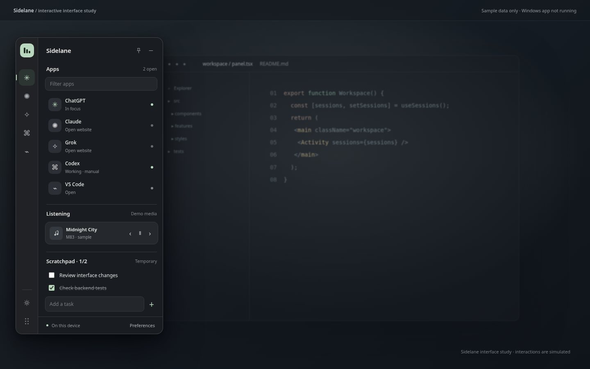

# Sidelane

A lightweight, customizable Windows sidebar for people switching between AI tools, code editors, music, and short tasks. Sidelane stays narrow until you hover or press **Ctrl+Alt+Space**. The expanded panel gives you your current tools without another dashboard to manage.



**Status: v1.0 Windows release preparation.** [Windows CI passed on 20 October 2026](https://github.com/Davittaai/Sidelane/actions/runs/39376540695) with 38 core tests, successful WPF compilation and a portable ZIP. The image above is a browser-rendered design concept, **not a screenshot of the compiled Windows app**. Automated Windows startup checks and hands-on QA have distinct acceptance criteria. See [release status](docs/V1-RELEASE-STATUS.md).

## What you get

- **Apps:** custom ChatGPT, Claude, Grok, Codex, VS Code or arbitrary web shortcuts, with Windows window switching when detectable.
- **Audio:** artist/track text and playback controls through Windows media-session integration when supported by the player.
- **Tasks:** a small disposable checklist, wiped when you exit. Task contents are never written to disk.
- **Status notes:** manually choose working, waiting or ready per app. Sidelane does **not** claim to detect AI generation states automatically.
- **Appearance:** dark surfaces, font choice, accent, opacity, background image, left/right/free positioning and optional autostart.
- **Privacy:** local JSON settings only. No accounts, telemetry, online AI integrations, conversation monitoring, or tracking.

## Download and launch on Windows

This source package contains everything required to **build** a self-contained Windows executable. You need a Windows x64 PC (Windows 11 recommended; Windows 10 Home is out of Microsoft support) and the [.NET 10 SDK](https://dotnet.microsoft.com/en-us/download/dotnet/10.0) to compile it once.

1. Extract `Sidelane-v1-source.zip`.
2. Double-click **`Build-Sidelane.cmd`** in the extracted folder.
3. When the checks and build finish successfully, launch **`release/Sidelane.exe`**.

You can also build manually:

```powershell
dotnet run --project tests/Sidelane.CoreTests/Sidelane.CoreTests.csproj -c Release
dotnet publish src/Sidelane/Sidelane.csproj -c Release -r win-x64 --self-contained true -p:PublishSingleFile=true -p:IncludeNativeLibrariesForSelfExtract=true -o release
```

For an already compiled download, get the [Sidelane-win-x64 artifact from the successful Windows workflow](https://github.com/Davittaai/Sidelane/actions/runs/39376540695/artifacts/12243850722). It is a self-contained x64 ZIP and includes SHA256 verification; GitHub sign-in may be required and CI artifacts expire. For Windows QA, follow [Windows verification](docs/WINDOWS-QA.md).

## Publishing the code to GitHub

The source repository is **[Davittaai/Sidelane](https://github.com/Davittaai/Sidelane)**. GitHub Actions builds and tests the Windows source on every push to `main`. [The first successful build](https://github.com/Davittaai/Sidelane/actions/runs/39376540695) passed 38 core tests and published a portable ZIP. Native usability checks remain outstanding, so this is still a release candidate rather than a tested stable release. See [milestones](docs/MILESTONES.md).

## Architecture and features

| Feature | Mechanism |
|---|---|
| Sidebar | Frameless WPF topmost window, hover expansion and drag handle |
| Windows detection | Win32 EnumWindows/process matching, adapted from Quick Apps Overlay (MIT) |
| Media | `Windows.Media.Control` system sessions, no Spotify API keys |
| Temporary scratchpad | WPF in-memory controls, deliberately not persisted |
| Preferences | Local `%APPDATA%/Sidelane/settings.json` with atomic replacement |
| Compatibility | .NET 10 LTS, Windows 11 recommended; Windows 10 behavior requires manual compatibility testing, x64 |
| Open source | MIT; third-party attribution in `THIRD_PARTY_NOTICES.md` |

Click a pinned app to focus a matching window or open its configured website. Right-click an app row to add or clear a **manual** activity note. App focus indicators read Windows foreground handles, not browser conversation data. The app yields to fullscreen applications by default, and starting with Windows is opt-in.

## Development and limitations

The source is intentionally free of external UI packages. It uses WPF and OS services rather than an Electron/browser runtime. Windows-targeted compilation and system integration require a Windows runner; this workspace can only check static markup and the separate HTML concept preview. The GitHub Actions workflow builds a self-contained portable x64 artifact and checksum.

Refer to [v1 release status](docs/V1-RELEASE-STATUS.md), [Windows QA](docs/WINDOWS-QA.md), [design rationale](docs/DESIGN.md), [security](SECURITY.md), and [contributing](CONTRIBUTING.md). Found a bug? Include Windows version, reproduction steps, and logs with private data removed.

## Credits

Built as a free and open-source portfolio project by Davit Naskidashvili. Inspired by lightweight desktop overlays, including [Quick Apps Overlay](https://github.com/vhvb1989/quick-apps-overlay). Portions of Win32 window management adapted under its MIT license. See [third-party notices](THIRD_PARTY_NOTICES.md).
