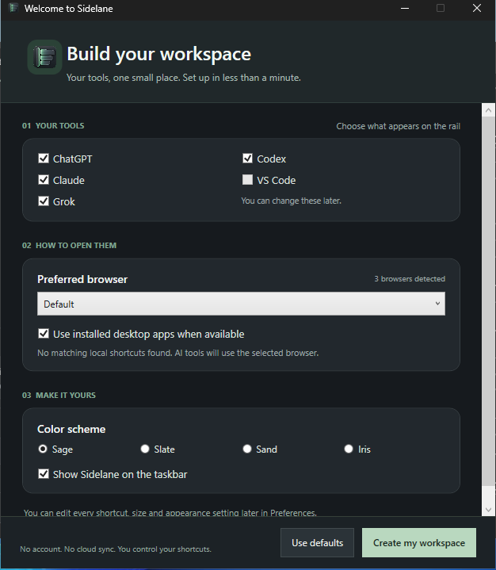
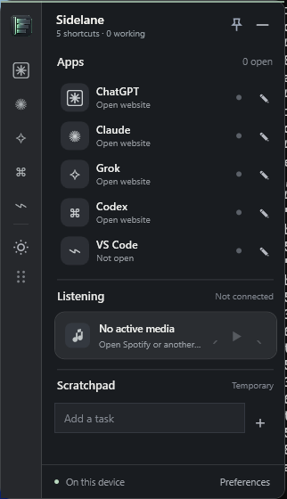

# Sidelane

**A workspace for the things you're working on.** A small, local-first Windows rail for launching ChatGPT, Claude, Grok, Codex and desktop apps, keeping track of what is open, controlling system media and jotting disposable tasks.

Native **.NET 10 / WPF**, no Electron, cloud account, analytics or background chat-history collection. MIT-licensed.

**[Download v2.0 Beta 1 Setup](https://github.com/Davittaai/Sidelane/releases/download/v2.0.0-beta.1/SidelaneSetup.exe)** · **[Portable ZIP](https://github.com/Davittaai/Sidelane/releases/download/v2.0.0-beta.1/Sidelane-win-x64.zip)** · [Release page and SHA256](https://github.com/Davittaai/Sidelane/releases/tag/v2.0.0-beta.1) · [Source and issues](https://github.com/Davittaai/Sidelane)

> **Beta release:** the app compiles, runs, and passes hosted Windows installer and core tests, but live multi-monitor/DPI, media, accessibility and browser-service verification still need real-device sign-off. [Stable v1.0](https://github.com/Davittaai/Sidelane/releases/tag/v1.0.0) remains available.

## This is v2

<table><tr><td width="64%"></td><td width="36%"></td></tr></table>

*Images are actual WPF captures from a Windows CI machine, cropped to the app boundaries, not design renders.*

The **new first-run experience** asks what tools you want, which installed browser should open them, whether to use detected desktop-app shortcuts, your theme, and whether the taskbar button should appear. New users are guided; existing saved profiles are preserved. Reopen **Quick setup...** from the tray at any time. Sidelane asks before replacing an existing profile.

**v2 feature highlights**

- **Native app or browser, your choice.** Every shortcut supports Browser, App or Auto mode. Pick Chrome, Edge, Firefox, Brave or Windows default, or choose a local EXE / Windows Start Menu shortcut. The quick setup uses exact Start Menu filename matches for supported AI tools. It never launches apps during discovery.
- **Fast desktop navigation.** Collapse/expand on hover, drag and pin the rail, customize its width/height, and choose placement. Press `/` to reveal a quick filter, `Enter` to open its first match, or `Escape` to clear/collapse.
- **Configurable hotkey.** Choose `Ctrl+Alt+Space`, `Ctrl+Shift+Space` or disable it. If another program has reserved the selected shortcut, Sidelane warns and attempts to keep the old binding.
- **Make it yours.** Sage, Slate, Sand and Iris themes, custom colors, local background image, fonts, opacity, taskbar button and animations. The v2 rail, dividers, media card and loading indicator share your theme. The rail and welcome screen use high-resolution Sidelane artwork.
- **Activity without surveillance.** See open or focused Windows applications. Type a short temporary task label next to any AI shortcut, or set a manual Working / Waiting / Ready status. Optional Chrome native messaging can observe Open / Generating / Recently stopped on supported pages. **Sidelane cannot read or infer actual task descriptions, percentage progress or successful completion from these signals.**
- **Small built-in helpers.** System media transport controls, including supported Spotify sessions, and a scratchpad whose contents disappear on app exit. Preferences can be exported/imported to a local JSON backup; session notes are not included.
- **Proper distribution.** Per-user Windows installer with shortcuts/uninstall, a portable self-contained ZIP, official-release update checks with approval and SHA256 verification. Both installers and portable ZIPs have published checksums.

## Get started

1. Run [SidelaneSetup.exe](https://github.com/Davittaai/Sidelane/releases/download/v2.0.0-beta.1/SidelaneSetup.exe) on Windows 10/11 x64. No separate .NET runtime installation needed. The app is **unsigned** and SmartScreen may prompt.
2. On first launch, select your tools, browser and appearance in **Build your workspace**. The welcome screen skips desktop-only tools that have no usable local shortcut.
3. Open **Preferences → Apps** for advanced per-shortcut launch settings; use **Appearance** and **Layout** to customize.
4. Use the tray menu for **Quick setup...**, updates and exit. A second launch focuses the running Sidelane instead of opening a duplicate.
5. If needed, read the [optional Chrome companion guide](companion/README.md). It is **not installed or activated automatically** and does not work with arbitrary Edge/Firefox/Brave provider tabs.

### Updating from v1.3

The installation uses the existing Sidelane profile at `%APPDATA%\Sidelane\settings.json`. Existing users keep their saved shortcuts, browser choices, size and theme. Quick Setup is opt-in when a profile already exists. Consider **Preferences → Export settings** before making major changes. Temporary tasks and activity notes were always session-only.

## Build, test and contribute

```powershell
dotnet run --project tests/Sidelane.CoreTests/Sidelane.CoreTests.csproj -c Release
dotnet publish src/Sidelane/Sidelane.csproj -c Release -r win-x64 --self-contained true -p:PublishSingleFile=true -p:IncludeNativeLibrariesForSelfExtract=true -o release
```

You need the [.NET 10 SDK](https://dotnet.microsoft.com/en-us/download/dotnet/10.0) for building. `Build-Sidelane.cmd` offers a local build entrypoint on Windows. Release CI also validates XAML handlers, browser-companion JS, the native host protocol, Windows process startup, the portable ZIP and install/uninstall.

See [what changed and what remains unverified](docs/V2-DELIVERY-AUDIT.md), [v2 beta notes](docs/RELEASE-NOTES-v2.md), [SECURITY](SECURITY.md), [MIT license](LICENSE) and [third-party notices](THIRD_PARTY_NOTICES.md). Earlier Win32 source derived from MIT-licensed Quick Apps Overlay is attributed. WPF UI / Microsoft PowerToys interaction patterns were researched, but no heavy external framework was vendored.

Developed as an open-source Windows portfolio application. Bugs, accessibility findings and tested screenshots are welcome via [GitHub Issues](https://github.com/Davittaai/Sidelane/issues).
