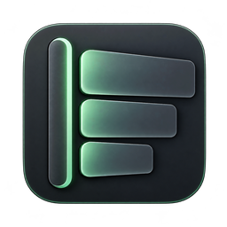
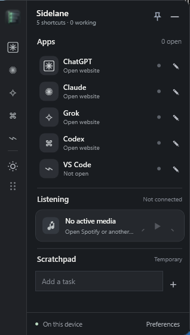
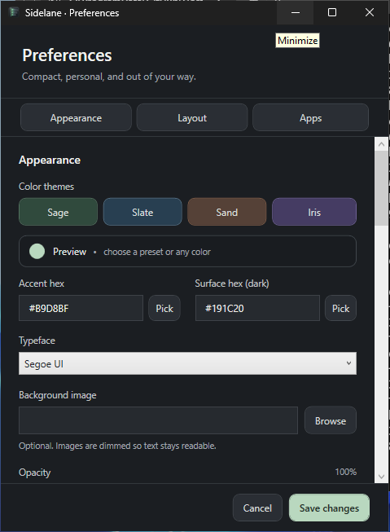

# Sidelane

A compact, customizable **Windows workspace rail** for your AI tools, desktop apps, browser profiles, media and temporary tasks. Native .NET 10 WPF, no Electron, no account, no telemetry.

<p></p>

**[Get v1.3 Beta 1 installer](https://github.com/Davittaai/Sidelane/releases/download/v1.3.0-beta.1/SidelaneSetup.exe)** · **[Portable ZIP](https://github.com/Davittaai/Sidelane/releases/download/v1.3.0-beta.1/Sidelane-win-x64.zip)** · [Release notes](docs/RELEASE-NOTES-v1.3-beta.md) · [Installer SHA256](https://github.com/Davittaai/Sidelane/releases/download/v1.3.0-beta.1/SidelaneSetup.sha256)

**Stable version:** [v1.0.0](https://github.com/Davittaai/Sidelane/releases/tag/v1.0.0). **Latest beta:** [v1.3.0-beta.1](https://github.com/Davittaai/Sidelane/releases/tag/v1.3.0-beta.1). The latest beta is a real downloadable Windows build, not a browser mockup. It still requires real-device QA before stable promotion.

## Native Windows screenshots

<table><tr><td></td><td></td></tr></table>

*Real WPF screenshots captured on a hosted Windows runner, not concept renders. Live AI services, browser selection and mixed-DPI user environments need separate device testing.*

## Features

- **Your size:** the collapsed rail starts at 46 display-independent pixels; the expanded view is 320 wide and 560 high. Change each dimension in Preferences, and position it left, right or freely.
- **Your colors:** coordinated Sage, Slate, Sand and Iris palettes, custom Windows color pickers, dark-surface contrast protection, opacity, local wallpaper and font choices.
- **Your apps or browser:** select **Auto** (focus a matching window first), **App** (launch the chosen `.exe` or Windows `.lnk` shortcut, including Store-app shortcuts), or **Browser** (default, Chrome, Edge, Firefox or Brave). Chromium browsers can open a standalone web-app window. The App option will not silently open the website.
- **Visibility and status:** an open native app can be detected from its process. The optional Chrome companion can observe open, generating and recently stopped states for ChatGPT, Claude and Grok, when supported by their current UI. Status is based on site controls; **Sidelane cannot automatically read or name your tasks**.
- **Your task labels:** use the pencil button beside an app to attach a manual, temporary description of what you're working on. Manual labels and disposable scratchpad tasks are held in memory only and clear at exit.
- **Music:** local Windows media-session title/artist and available playback controls, including Spotify when its Windows session supports them.
- **Motion:** subtle entry animation, short loading indicator, and small animated bars when an opted-in browser reports generation. Disable animations in Preferences.
- **Windows integration:** taskbar icon while open (configurable), system-tray controls, Ctrl+Alt+Space visibility shortcut, optional login launch, standard installer and uninstall entry, and consent-based checks for verified GitHub updates.

## Install

1. Download [SidelaneSetup.exe](https://github.com/Davittaai/Sidelane/releases/download/v1.3.0-beta.1/SidelaneSetup.exe), or use the [portable ZIP](https://github.com/Davittaai/Sidelane/releases/download/v1.3.0-beta.1/Sidelane-win-x64.zip) without installation.
2. The self-contained Windows x64 app does **not** require installing the .NET SDK. The binary is **unsigned**, so SmartScreen may warn. Verify its [SHA256](https://github.com/Davittaai/Sidelane/releases/download/v1.3.0-beta.1/SidelaneSetup.sha256) and use files only from the official repository.
3. Open **Preferences → Apps**. Choose the shortcut, launch mode, selected browser or installed application file, and optionally the activity provider. Choose **Appearance** and **Layout** to personalize the rail.
4. Press **Ctrl+Alt+Space** to show the overlay; hover to expand; use the pencil by an AI app to describe a task without saving its content.

**Optional Chrome companion:** not installed or activated automatically. [Instructions and privacy boundaries](companion/README.md). The native app works independently without this extension. Other browsers may be chosen for launching, but automatic AI activity observation is currently an experimental **Chrome-only** integration.

## Building and verification

```powershell
dotnet run --project tests/Sidelane.CoreTests/Sidelane.CoreTests.csproj -c Release
dotnet publish src/Sidelane/Sidelane.csproj -c Release -r win-x64 --self-contained true -p:PublishSingleFile=true -p:IncludeNativeLibrariesForSelfExtract=true -o release
```

Or run `Build-Sidelane.cmd` on Windows with the [.NET 10 SDK](https://dotnet.microsoft.com/en-us/download/dotnet/10.0).

The v1.3 beta engineering suite passed **73/73 core tests**, warning-as-error WPF compilation, native process launch, local native-messaging protocol checks, and installer install/uninstall checks: [Windows CI evidence](https://github.com/Davittaai/Sidelane/actions/runs/40297630824). Those checks do not validate real live Chrome service markup, hotkey conflicts, mixed monitor/DPI setups or the user's Spotify sessions. Track outstanding acceptance in [Windows QA](docs/WINDOWS-QA.md), [UX review](docs/UX-REVIEW-v1.3.md), and [Issues](https://github.com/Davittaai/Sidelane/issues).

## Architecture, privacy and credits

Local preferences are stored at `%APPDATA%\Sidelane\settings.json`; tasks and manual labels are session-only. The optional companion sends short provider/state pairs over Chrome native messaging and a current-user named pipe, not transcripts, prompts or replies. The in-app stable update checker uses official GitHub releases and verifies SHA256 before opening a user-approved installer. See [SECURITY.md](SECURITY.md).

License: [MIT](LICENSE). Portions of the Win32 window management were adapted from [Quick Apps Overlay](https://github.com/vhvb1989/quick-apps-overlay) under MIT (see [third-party notices](THIRD_PARTY_NOTICES.md)). Design and launch references included [WPF UI](https://github.com/lepoco/wpfui), [PixiEditor ColorPicker](https://github.com/PixiEditor/ColorPicker), and [BrowserPicker](https://github.com/mortenn/BrowserPicker); no heavy UI framework was vendored.

Built as a free, open-source portfolio project by Davit Naskidashvili.
