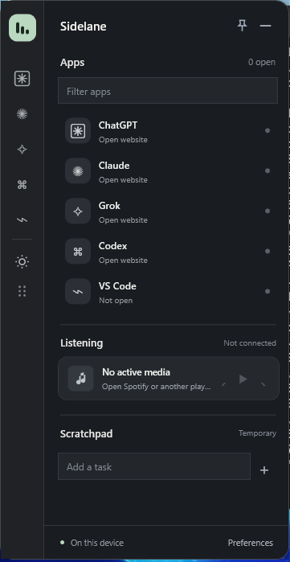

# Sidelane

A lightweight, customizable Windows sidebar for people switching between AI tools, code editors, music, and short tasks. Sidelane stays narrow until you hover or press **Ctrl+Alt+Space**. The expanded panel gives you your current tools without another dashboard to manage.



**Stable release: [Sidelane v1.0.0](https://github.com/Davittaai/Sidelane/releases/tag/v1.0.0), October 20, 2026.** The Windows release passed 38 core checks, warning-free WPF compilation, a real Windows process-startup smoke test, and checksum verification. The image above is an **actual WPF application screenshot** from an isolated Windows CI desktop; it does not replace hands-on laptop QA. Real-desktop interaction and media testing remain to be documented in [Windows QA](docs/WINDOWS-QA.md).

## What you get

- **Apps:** custom ChatGPT, Claude, Grok, Codex, VS Code or arbitrary web shortcuts, with Windows window switching when detectable.
- **Audio:** artist/track text and playback controls through Windows media-session integration when supported by the player.
- **Tasks:** a small disposable checklist, wiped when you exit. Task contents are never written to disk.
- **Status notes:** manually choose working, waiting, ready, or add a **session-only activity note** from the app's right-click menu (v1.1 preview). The note appears in the compact-rail tooltip and clears on exit. Sidelane does **not** detect AI generation states automatically.
- **Appearance:** dark surfaces, font choice, accent, opacity, background image, left/right/free positioning and optional autostart.
- **Privacy:** local JSON settings only. No accounts, telemetry, online AI integrations, conversation monitoring, or tracking.

**Preview for testers:** [Sidelane v1.1.0-beta.2](https://github.com/Davittaai/Sidelane/releases/tag/v1.1.0-beta.2) includes temporary per-app notes and launch improvements. It is not a stable release until real-device QA is documented.

## Download and run on Windows

**[Download Sidelane v1.0.0 (Windows x64 ZIP)](https://github.com/Davittaai/Sidelane/releases/download/v1.0.0/Sidelane-win-x64.zip)** · [SHA256 checksum](https://github.com/Davittaai/Sidelane/releases/download/v1.0.0/Sidelane-win-x64.sha256) · [Release notes](https://github.com/Davittaai/Sidelane/releases/tag/v1.0.0)

1. Download the Windows ZIP and extract it to a regular folder, for example `C:\Tools\Sidelane`.
2. Double-click **`Sidelane.exe`**. The Windows x64 executable is self-contained, so users **do not** need the .NET SDK.
3. Hover the 54-pixel rail to expand; right-click for options; press **Ctrl+Alt+Space** to show the sidebar. Open **Preferences** to customize shortcuts and the appearance.
4. Use the system-tray icon or the sidebar context menu to exit. Temporary tasks and manual AI status labels clear when the app exits.

The executable is **unsigned**. Windows SmartScreen may warn about an unfamiliar publisher. Verify the download checksum and only run files you trust. Read `README-START.txt` in the archive.

**Building from source instead:** On Windows, install the [.NET 10 SDK](https://dotnet.microsoft.com/en-us/download/dotnet/10.0), then double-click `Build-Sidelane.cmd` or run:

```powershell
dotnet run --project tests/Sidelane.CoreTests/Sidelane.CoreTests.csproj -c Release
dotnet publish src/Sidelane/Sidelane.csproj -c Release -r win-x64 --self-contained true -p:PublishSingleFile=true -p:IncludeNativeLibrariesForSelfExtract=true -o release
```

## Repository and verification

The public source is at **[Davittaai/Sidelane](https://github.com/Davittaai/Sidelane)**, with an MIT license, source tests, Windows CI, and a permanent [v1.0.0 GitHub Release](https://github.com/Davittaai/Sidelane/releases/tag/v1.0.0). CI passed 38 core tests, compiled the WPF application with warnings treated as errors, launched the executable successfully on a Windows runner, and produced checksum-verified release assets.

This automated startup check is **not a substitute** for hands-on GUI testing. Windows DPI and multi-monitor positioning, media sessions, and fullscreen coexistence still need real-device QA. See [Windows checklist](docs/WINDOWS-QA.md) and [milestones](docs/MILESTONES.md).

## Architecture and features

| Feature | Mechanism |
|---|---|
| Sidebar | Frameless WPF topmost window, hover expansion and drag handle |
| Windows detection | Win32 EnumWindows/process matching, adapted from Quick Apps Overlay (MIT) |
| Media | `Windows.Media.Control` system sessions, no Spotify API keys |
| Temporary scratchpad | WPF in-memory controls, deliberately not persisted |
| Preferences | Local `%APPDATA%/Sidelane/settings.json` with atomic replacement |
| Compatibility | .NET 10 LTS, Windows 11 recommended; Windows 10 behavior requires manual compatibility testing, x64 |
| Open source | MIT; third-party attribution in `THIRD_PARTY_NOTICES.md` |

Click a pinned app to focus a matching window or open its configured website. Right-click an app row to add or clear a **manual** activity note. App focus indicators read Windows foreground handles, not browser conversation data. The app yields to fullscreen applications by default, and starting with Windows is opt-in.

## Development and limitations

The source is intentionally free of external UI packages. It uses WPF and OS services rather than an Electron/browser runtime. Windows-targeted compilation and system integration require a Windows runner; this workspace can only check static markup and the separate HTML concept preview. The GitHub Actions workflow builds a self-contained portable x64 artifact and checksum.

Refer to [v1 release status](docs/V1-RELEASE-STATUS.md), [Windows QA](docs/WINDOWS-QA.md), [design rationale](docs/DESIGN.md), [security](SECURITY.md), and [contributing](CONTRIBUTING.md). Found a bug? Include Windows version, reproduction steps, and logs with private data removed.

## Credits

Built as a free and open-source portfolio project by Davit Naskidashvili. Inspired by lightweight desktop overlays, including [Quick Apps Overlay](https://github.com/vhvb1989/quick-apps-overlay). Portions of Win32 window management adapted under its MIT license. See [third-party notices](THIRD_PARTY_NOTICES.md).
